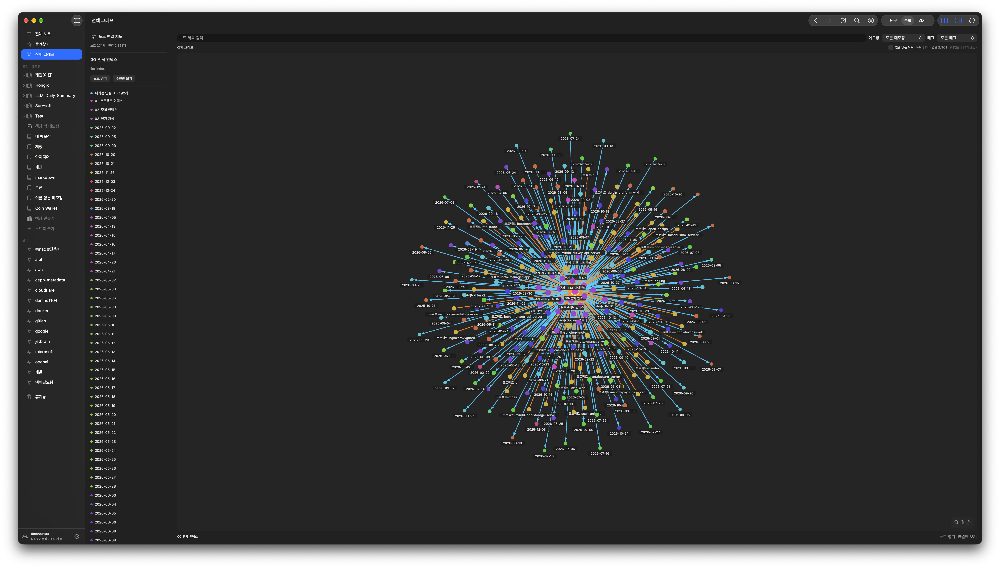

<h1 align="center">Synology Markdown Note</h1>

<div align="center">

**A macOS app, web client, and CLI for writing and managing Synology Note Station notes in Markdown.**
  
[](https://github.com/damho1104/synology-markdown-note/releases)
[](https://github.com/damho1104/synology-markdown-note/pkgs/container/synology-md-note-web)
[](LICENSE)

,_Linux(Arm64,x86__64)-8b5cf6?style=for-the-badge)

</div>

<p align="center">
  <a href="https://buymeacoffee.com/damho1104q">
    
  </a>
</p>

<p align="center">
  <strong>English</strong> | <a href="README_KO.md">한국어</a>
</p>

---

Use the shelves, notebooks, and notes already on your NAS. Work in the dedicated Mac app, access your notes from a browser on other devices, or use the `synonote` command in your terminal.

[Download app & CLI](https://github.com/damho1104/synology-markdown-note/releases/latest) · [Install the web client](web/SELF-HOSTING.md) · [CLI guide](cli/README.md)


This is an independent open-source project, not an official product made or supported by Synology. Synology and Note Station are trademarks of their respective owners.

## Choose your client

| Client | Requirements | Best for |
| --- | --- | --- |
| **macOS app** | macOS 14 or later · Apple Silicon | Editing and searching on your Mac, including offline work |
| **Web** | Browser + Docker server | Accessing NAS notes without installing an app on each device |
| **CLI (`synonote`)** | macOS · Linux x86_64 | Browsing notes, uploading and downloading Markdown, and scripting |

All clients require **a Synology NAS with Note Station installed and a NAS account**. Install the web client once on a server running Docker, then connect through your browser.

## Features

### macOS app

- **Markdown editing:** Source, split, and reading views; edit existing standard Note Station notes.
- **Autosave and sync:** Save changes locally on your Mac first, then upload to your NAS. Work offline and sync when you reconnect.
- **Document previews:** Mermaid diagrams, KaTeX math, images, and attachments.
- **Search and connections:** Full-text search, internal links, backlinks, and global and local note graphs.
- **Note organization:** Shelves, notebooks, tags, favorites, move, trash, restore, and Markdown import and export.

### Web

- **Browser editing:** Source, split, and reading views with autosave.
- **Document previews:** Mermaid and math previews, math saved as PNG images, and previews that follow the paragraph being edited.
- **Search and connections:** Search titles, previews, and tags; internal links, backlinks, and global and local note graphs.
- **Note organization:** Shelves, notebooks, tags, favorites, move, trash, and restore.
- **Appearance settings:** Collapsible shelf and note lists, light and dark themes, and editor and diagram settings.

### CLI

- **Browse your NAS:** List shelves, notebooks, and notes, and view their details.
- **Markdown files:** Upload and download files; review differences before overwriting existing notes.
- **Knowledge indexes:** Organize daily summary notes by project, topic, and related knowledge.
- **Automation:** JSON output, two-factor authentication, and saved login credentials.

## Screenshots

The macOS app with Markdown source and split preview.


Explore connections between notes in the global graph.



## Tech stack

| Component | Technologies and purpose |
| --- | --- |
| **macOS app** | Swift, SwiftUI, and AppKit for the desktop app; WebKit for document previews; Swift Package Manager for builds |
| **Markdown and HTML** | swift-markdown and SwiftSoup for Markdown parsing and HTML processing in the macOS app |
| **Web frontend** | React, TypeScript, Vite, and Tailwind CSS for the browser UI; CodeMirror for the editor |
| **Web backend** | Python 3.13, FastAPI, and Uvicorn for the API; HTTPX for NAS requests; SQLite for local state and cryptography for encryption |
| **Document rendering** | Mermaid for diagrams and KaTeX for math; marked and DOMPurify for rendering and sanitizing Markdown in the web client |
| **CLI** | Python 3.13, Typer, HTTPX, markdown-it-py, and keyring; uv for dependency management and PyInstaller for standalone executables |
| **Storage and deployment** | Synology Note Station for NAS notes; SQLite for macOS local data and web server state; Docker Compose and GHCR images for web deployment on amd64 and arm64 |

## Install the macOS app

1. Open the [latest release](https://github.com/damho1104/synology-markdown-note/releases/latest) and download `SynologyMarkdownNote-<version>-arm64.dmg` from **Assets**.
2. Open the DMG and drag **Synology Markdown Note.app** to **Applications**.
3. Launch the app and sign in with your NAS address and account under **Settings → Note Station**.

### ⚠️ Important
The released app and CLI do not require source code or a separate Python installation. The macOS app uses a self-signed certificate and is not notarized by Apple. If macOS blocks it, verify the download source, then follow the instructions in **System Settings → Privacy & Security** to open it.

For checksums and installation details, see the [installation and distribution guide](docs/distribution.md).

### Getting started

- Select a notebook, then choose **New Note** or press `⌘N`.
- Press `⇧⌘P` to toggle the preview and `⇧⌘F` to search notes.
- Type `[[` while editing to find and link another note.
- Import existing Markdown files through **File → Import Markdown…**.
- To keep all notes available offline, enable full body and attachment storage under **Settings → Note Station → Offline Storage**.

## Install the web client

Run these commands on a server with Docker and Docker Compose v2 installed. Compose uses the `ghcr.io/damho1104/synology-md-note-web:latest` image from GHCR; no local source build is required.

```sh
# 1. Create an installation directory
mkdir -p ~/synology-md-note-web && cd ~/synology-md-note-web

# 2. Download the configuration files
wget https://raw.githubusercontent.com/damho1104/synology-markdown-note/main/web/docker-compose.yaml
wget -O .env https://raw.githubusercontent.com/damho1104/synology-markdown-note/main/web/.env.example

# 3. Adjust the settings you need in .env
# For a NAS on a private network: NAS_ALLOW_PRIVATE=true
# For direct access from another computer: WEB_BIND_ADDRESS=0.0.0.0

# 4. Start the service
docker compose up -d
```

Open `http://localhost:8787` on the same computer, or `http://<server-address>:8787` from another computer. By default, access is limited to the same computer.

If you have not already set the NAS address in `.env`, retrieve the initial setup code:

```sh
docker compose exec web cat /data/setup-code
```

Enter your NAS address and the code on the initial setup screen, then sign in with your NAS account. Keys and codes are generated automatically. **A CA path is not required for a standard installation.**

### Using and updating the web client

Select a note and edit it in source or split view to save automatically. Check the save status at the bottom of the screen. Open settings at the bottom of the sidebar to adjust appearance and editor options or view the app version.

To update, run these commands from your existing installation directory:

```sh
docker compose pull web
docker compose up -d
```

Keep your existing `.env` and data volume. For private-network NAS access, HTTPS proxies, optional CA certificates, storage, and backup examples, see the [self-hosting guide](web/SELF-HOSTING.md).

## Install the CLI

Download the executable and checksum file for your platform from **Assets** on the [latest release](https://github.com/damho1104/synology-markdown-note/releases/latest). Replace `<VERSION_TAG>` with that release's tag.

| Platform | Executable | Checksum file |
| --- | --- | --- |
| macOS · Apple Silicon | `synonote-cli-<VERSION_TAG>-macos-arm64` | `SHA256SUMS-macos-arm64` |
| Linux x86_64 · glibc 2.28 or later | `synonote-cli-<VERSION_TAG>-linux-glibc2.28-amd64` | `SHA256SUMS-linux-glibc2.28-amd64` |
| Ubuntu 22.04 x86_64 | `synonote-cli-<VERSION_TAG>-ubuntu-22.04-amd64` | `SHA256SUMS-ubuntu-22.04-amd64` |
| Ubuntu 24.04 x86_64 | `synonote-cli-<VERSION_TAG>-ubuntu-24.04-amd64` | `SHA256SUMS-ubuntu-24.04-amd64` |

The portable Linux executable supports Debian, Ubuntu, AlmaLinux, Rocky Linux, Fedora, and openSUSE. **CLI release executables do not support Linux ARM64, Alpine (musl), or 32-bit systems.** The web Docker image supports amd64 and arm64.

For permissions, PATH setup, and checksum verification, see the [CLI installation guide](cli/README.md#installation).

### CLI examples

```sh
synonote login --server https://nas.example.com:5001 --username alice --remember
synonote notebook list --stack 'Work'
synonote upload ./report.md --stack 'Work' --notebook 'Journal'
synonote download --id NOTE_ID --output ./downloaded-report.md
```

See the [CLI guide](cli/README.md) for detailed commands and index examples.

### Build the CLI from source (optional)

With `uv` installed, run these commands from the repository root on macOS or Linux.

```sh
cd cli
uv python install
uv run --locked python build_onefile.py
```

PyInstaller builds a standalone executable at `cli/dist/synonote`. See the [CLI build guide](cli/README.md#building-a-onefile-executable-from-source-optional) for installation steps.

## Before you start

- **NAS connection:** The app and CLI use HTTPS NAS addresses. The web client also supports private-network and HTTP NAS addresses when `NAS_ALLOW_PRIVATE=true`. HTTP connections do not encrypt credentials or notes in transit. Connecting with only a QuickConnect ID or bypassing certificate verification is not supported.
- **Feature differences:** Adding and deleting general attachments, version history, and offline sync in the web client are not on par with the macOS app. The CLI works with individual files and does not provide automatic sync or merging. Editing the body of encrypted notes is not supported.
- **Credentials:** The macOS app and CLI can use Keychain. On Linux, CLI `--remember` stores a plaintext credentials file with permissions restricted to the current user. The web client encrypts persistent login information on the server. See [CLI authentication](cli/README.md#login-and-automatic-login) and [web data storage](web/README.md#data-storage-and-permissions).
- **Backups:** Your original notes are on the NAS. Keep Note Station backups, and back up the web `/data` directory and macOS local data separately as needed.

## Learn more

- [Documentation index](docs/README.md)
- [Web self-hosting](web/SELF-HOSTING.md)
- [Web features and support scope](web/README.md)
- [CLI guide](cli/README.md)
- [App and CLI installation and distribution](docs/distribution.md)
- [Diagnostic logs](docs/diagnostics.md)
- [Development environment](docs/development-signing.md) · [Release management](docs/github-release.md)

## License and support

This project's own source code and documentation are available under the [MIT License](LICENSE). External libraries and resources retain their respective licenses. See the notices for the bundled [Mermaid](Sources/SynologyNote/Resources/MERMAID-LICENSE.txt) and [KaTeX](Sources/SynologyNote/Resources/KATEX-LICENSE.txt) resources.

See [CONTRIBUTING.md](CONTRIBUTING.md) for contribution guidelines and [SECURITY.md](SECURITY.md) to report security issues.

## Star History

<a href="https://www.star-history.com/?repos=damho1104%2Fsynology-markdown-note&type=date&legend=top-left">
 <picture>
   <source media="(prefers-color-scheme: dark)" srcset="https://api.star-history.com/chart?repos=damho1104/synology-markdown-note&type=date&theme=dark&legend=top-left" />
   <source media="(prefers-color-scheme: light)" srcset="https://api.star-history.com/chart?repos=damho1104/synology-markdown-note&type=date&legend=top-left" />
   
 </picture>
</a>
