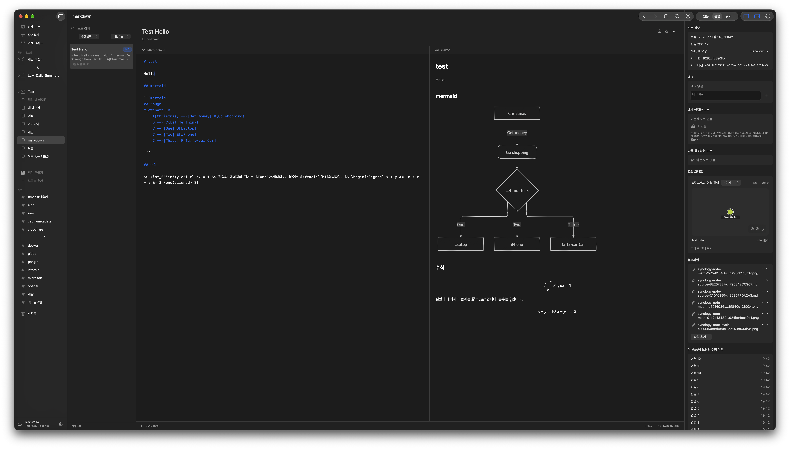

# Synology Markdown Note

**Synology Note Station을 Markdown으로 활용하는 macOS 앱과 CLI**를 제공합니다.

Synology가 제작하거나 지원하는 공식 제품이 아닌 독립적인 오픈소스 프로젝트입니다. Synology 및 Note Station 명칭은 해당 권리자의 상표입니다.

macOS 앱에서는 기존 NAS의 책장·메모장·노트를 그대로 활용해 Markdown 편집, 노트 간 연결, 검색을 사용할 수 있습니다. 변경 내용은 NAS에 자동 동기화되며 오프라인 편집도 가능합니다. 별도 제공하는 **`synonote` CLI**로는 터미널에서 Markdown 파일을 업로드·다운로드하고 노트를 탐색할 수 있습니다.

[다운로드](https://github.com/damho1104/synology-markdown-note/releases/latest) · [설치](#설치) · [사용 방법](#사용-방법) · [CLI 상세 안내](cli/README.md)

## 화면 미리보기

**Markdown 원문과 미리보기를 나란히 보며 편집합니다.** Mermaid 다이어그램과 수식을 미리보기에서 확인하고, 오른쪽 패널에서 노트 정보·연결·첨부파일을 관리할 수 있습니다.



**노트 간 연결을 전체 그래프로 탐색합니다.** 노트를 선택해 연결 관계를 확인하고 제목·메모장·태그로 원하는 노트를 찾을 수 있습니다.


## 주요 기능

### macOS 앱

- **Markdown 편집** — 소스 편집, 읽기 및 분할 미리보기. 기존 Note Station의 일반 노트는 서식 편집기로 열어 수정할 수 있습니다.
- **자동 동기화와 오프라인 작업** — 변경 내용을 먼저 Mac에 저장하고 NAS에 전송합니다. 연결이 끊기면 변경 사항을 보관했다가 재연결 후 전송합니다.
- **노트 정리** — 책장·메모장 관리, 태그, 즐겨찾기, 노트 이동, 휴지통과 복원.
- **검색** — 노트 본문 전문 검색, 제목·태그·날짜 등의 조건 검색과 스마트 메모장.
- **노트 연결** — `[[`로 다른 노트를 검색해 연결하고, 백링크와 전체·주변 노트 그래프로 관계를 살펴볼 수 있습니다.
- **풍부한 문서** — 이미지·첨부파일, Mermaid 다이어그램, KaTeX 수식, Markdown 가져오기·내보내기.

### CLI (`synonote`)

- **NAS 탐색** — 책장·메모장·노트 목록과 노트 정보 조회.
- **Markdown 업로드·다운로드** — 지정한 메모장에 `.md` 파일을 올리고 검증된 Markdown 노트를 파일로 저장.
- **안전한 덮어쓰기** — 기존 노트와 차이점 비교, 충돌·지원하지 않는 문서 변경 차단.
- **지식 인덱스 생성** — 일일 요약 노트를 프로젝트·주제·연관 지식별로 정리하고, 적용 전에 변경 사항 미리 확인.
- **스크립트 연동** — JSON 출력, 2단계 인증 및 로그인 정보 저장 지원.

## 설치

[최신 릴리스](https://github.com/damho1104/synology-markdown-note/releases/latest)의 **Assets**에서 아래 표에 맞는 파일과 체크섬을 다운로드하세요. **완성된 앱·CLI를 설치할 때는 소스 코드, Python, uv를 설치할 필요가 없습니다.**

공통으로 Synology NAS의 **Note Station**과 NAS 접속 계정이 필요합니다. 앱은 macOS용이며, Linux에서는 터미널용 CLI를 제공합니다.

### 어떤 파일을 받으면 되나요?

`<VERSION_TAG>`는 `v1.2.17`, `<VERSION>`은 `1.2.17`처럼 릴리스에 표시된 값으로 바꿉니다. `amd64`와 `x86_64`는 같은 CPU 아키텍처를 뜻합니다.

| 사용 환경 | 다운로드 파일 | 체크섬 파일 |
| --- | --- | --- |
| macOS 14+ / Apple Silicon — 앱 | `SynologyMarkdownNote-<VERSION>-arm64.dmg` | `SHA256SUMS-macos-arm64` |
| macOS / Apple Silicon — CLI | `synonote-cli-<VERSION_TAG>-macos-arm64` | `SHA256SUMS-macos-arm64` |
| Linux / x86_64 / glibc 2.28+ — 공용 CLI | `synonote-cli-<VERSION_TAG>-linux-glibc2.28-amd64` | `SHA256SUMS-linux-glibc2.28-amd64` |
| Ubuntu 22.04 / x86_64 — 전용 CLI | `synonote-cli-<VERSION_TAG>-ubuntu-22.04-amd64` | `SHA256SUMS-ubuntu-22.04-amd64` |
| Ubuntu 24.04 / x86_64 — 전용 CLI | `synonote-cli-<VERSION_TAG>-ubuntu-24.04-amd64` | `SHA256SUMS-ubuntu-24.04-amd64` |

**Linux 공용 CLI는 여러 배포판에서 같은 실행 파일 하나를 사용합니다.** Debian·AlmaLinux·Rocky Linux·Fedora·openSUSE 사용자는 `linux-glibc2.28-amd64` 파일을 선택하세요. Ubuntu에서도 공용 파일을 사용할 수 있으며, 22.04·24.04용 전용 파일도 별도로 제공합니다. 배포판마다 이름이 다른 실행 파일을 받을 필요는 없습니다.

공용 CLI는 Debian 11·12·13, Ubuntu 20.04·22.04·24.04, AlmaLinux 8·9, Rocky Linux 8·9, Fedora 43, openSUSE Leap 16.0의 **12개 컨테이너 환경에서 기본 실행을 검증**합니다. 검사 항목은 버전·도움말·한글 설정 경로·로그아웃·SSL 클라이언트 초기화입니다. 실제 NAS 로그인·업로드·다운로드 검증은 별도입니다. Alpine(musl), Linux ARM64, 32비트용 릴리스 파일은 제공하지 않습니다.

### macOS 앱 설치

1. 최신 릴리스에서 `SynologyMarkdownNote-<VERSION>-arm64.dmg`를 다운로드합니다.
2. DMG를 열고 **Synology Markdown Note.app**을 **Applications(응용 프로그램)** 폴더로 드래그합니다.
3. 앱을 실행하고 설정에서 NAS에 로그인합니다.

macOS 체크섬 파일에는 앱·CLI 등 여러 파일이 포함됩니다. DMG만 받은 경우에는 `SHA256SUMS-macos-arm64`에서 해당 DMG의 해시를 찾아 `shasum -a 256 '다운로드한 파일.dmg'` 출력과 비교하세요. 목록의 파일을 전부 받았다면 `shasum -a 256 -c SHA256SUMS-macos-arm64`로 일괄 확인할 수 있습니다.

> 릴리스 앱은 자체 서명 인증서로 서명하며 Apple Developer ID 서명·공증을 받지 않았습니다. macOS가 실행을 차단하면 파일 출처를 확인한 뒤 **시스템 설정 → 개인정보 보호 및 보안**의 열기 안내를 따르세요. [설치·배포 상세 안내](docs/distribution.ko.md)

### Linux CLI 설치

먼저 대상 환경을 확인합니다.

```sh
uname -m                 # x86_64
getconf GNU_LIBC_VERSION # glibc 2.28 이상
```

아래는 **v1.2.17 공용 CLI** 예시입니다. 선택한 릴리스의 실행 파일과 체크섬을 같은 폴더에 받은 뒤 실행합니다. 다른 버전은 파일명의 태그를 바꾸세요.

```sh
sha256sum --check SHA256SUMS-linux-glibc2.28-amd64
mkdir -p "$HOME/.local/bin"
install -m 755 ./synonote-cli-v1.2.17-linux-glibc2.28-amd64 "$HOME/.local/bin/synonote"
export PATH="$HOME/.local/bin:$PATH"
synonote version
```

`PATH` 설정은 사용하는 셸의 설정 파일에도 추가하세요. Ubuntu 전용 파일과 macOS CLI의 설치 절차는 [CLI 설치 안내](cli/README.md#설치)를 참고하세요.

## 사용 방법

### macOS 앱

1. **NAS 연결:** 앱의 **설정 → Note Station**에서 NAS의 HTTPS 주소(예: `https://nas.example.com:5001`), 사용자 이름, 비밀번호를 입력하고 **로그인**을 누릅니다. 2단계 인증을 사용하면 인증 코드도 입력합니다.
2. **노트 작성:** 왼쪽에서 메모장을 선택하고 상단 **새 노트** 버튼 또는 `⌘N`을 누릅니다. 기존 노트를 선택해 바로 편집해도 됩니다.
3. **미리보기·검색:** Markdown 노트의 보기 모드를 전환하거나 `⇧⌘P`로 미리보기를 켜고 끕니다. `⇧⌘F`로 전체 노트를 검색할 수 있습니다.
4. **동기화:** 편집 내용은 자동 저장·전송됩니다. 전송 상태는 설정의 **동기화**에서 확인할 수 있고, 연결이 끊겼다면 재연결 후 전송됩니다.

다른 노트로 연결하려면 Markdown 편집 중 `[[`를 입력하세요. 기존 `.md` 파일은 **파일 → Markdown 가져오기…**로 추가할 수 있습니다.

**오프라인 사용 팁:** 아직 열어보지 않은 노트까지 내려받으려면 **설정 → Note Station → 오프라인 보관**에서 **전체 노트 본문·첨부를 이 Mac에 보관**을 켜세요. 새 메모장을 만들거나 NAS에서 처음 노트를 가져오려면 연결이 필요합니다.

### CLI

설치한 실행 파일을 직접 실행합니다.

```shell
synonote login --server https://nas.example.com:5001 --username alice --remember
synonote notebook list --stack '업무'
synonote upload ./report.md --stack '업무' --notebook '일지'
synonote download --id NOTE_ID --output ./downloaded-report.md
```

일일 요약 인덱스 생성은 `synonote index build`로 실행할 수 있으며, 기본적으로 변경 사항만 미리 보여 줍니다. 자세한 옵션과 사용 예시는 [CLI 사용법](cli/README.md)을 참고하세요.

## 알아두기

- Note Station이 설치된 NAS를 사용하며, 별도의 로컬 전용 메모장 모드는 제공하지 않습니다.
- NAS 주소는 **HTTPS URL**을 입력해야 합니다. QuickConnect ID만으로 접속하거나 인증서 검증을 우회하는 방식은 지원하지 않습니다.
- 암호화된 Note Station 노트의 본문 편집은 지원하지 않습니다.
- macOS 앱·CLI의 로그인 비밀번호와 기기 인증 정보는 **키체인**에 보관할 수 있습니다. Linux CLI에서 `login --remember`를 사용하면 비밀번호·신뢰 기기 정보를 `~/.config/synonote/credentials.json`에 **평문으로 저장**합니다(`XDG_CONFIG_HOME` 지정 시 해당 경로 사용). 디렉터리는 `0700`, 파일은 `0600` 권한으로 제한하며 `logout`으로 삭제할 수 있습니다. [인증 정보 저장 방식](cli/README.md#로그인과-자동-로그인)
- CLI는 파일 단위 업로드·다운로드 도구로, macOS 앱과 같은 자동 동기화·자동 병합 기능은 제공하지 않습니다.

## 소스에서 빌드하기

일반 설치는 위의 릴리스 파일을 사용하세요. 직접 빌드하거나 개발하려면 저장소를 복제합니다. `main`은 정식 배포 기준, `develop`은 개발·통합 브랜치입니다.

```sh
git clone --branch main https://github.com/damho1104/synology-markdown-note.git
cd synology-markdown-note
```

macOS 앱은 호환되는 Xcode 또는 Command Line Tools와 Python 3가 필요합니다.

```sh
./script/build_and_run.sh --build
open "dist/Synology Markdown Note.app"
```

빌드 과정의 Credential Helper·로컬 개발 인증서 설정은 [개발 빌드 안내](docs/development-signing.ko.md)를 참고하세요.

CLI는 [uv](https://docs.astral.sh/uv/) 설치 후 사용할 OS·아키텍처에서 빌드합니다.

```sh
cd cli
uv python install 3.13
uv sync --locked
uv run --locked python build_onefile.py
```

결과는 `cli/dist/synonote`(macOS/Linux), `cli/dist/synonote.exe`(Windows)입니다. Windows용 소스 빌드 안내는 [CLI 문서](cli/README.md#소스에서-onefile-빌드-선택)를 참고하세요. 게시된 릴리스 파일의 지원 환경은 위 다운로드 표를 기준으로 합니다.

## 개발 및 테스트

저장소 루트에서 Swift 테스트를 실행합니다. Swift Testing을 포함하고 선택한 컴파일러와 호환되는 Xcode 또는 Command Line Tools가 필요합니다.

```shell
./script/test.sh
```

CLI 테스트는 저장소 루트에서 다음과 같이 실행합니다.

```shell
cd cli
uv python install 3.13
uv sync --locked
uv run --locked pytest -q tests
```

[GitHub Actions CI](.github/workflows/ci.yml)는 `develop`·`main` 브랜치에 대한 push, Pull Request, 수동 실행 시 저장소에 등록한 **셀프호스팅 러너**에서 다음을 검사합니다.

- **macOS:** Swift 테스트 실행.
- **Ubuntu 24.04 / Python 3.13:** CLI 잠금 파일 확인 및 테스트 실행.

[Release 워크플로](.github/workflows/release.yml)는 `v1.2.17` 또는 `1.2.17`처럼 **`main`에 반영된 커밋에 commit 접미사 없는 버전 태그**를 푸시하면 테스트·빌드·체크섬 검증 후 GitHub Releases에 자동 업로드합니다. 태그 버전은 `cli/pyproject.toml`의 버전과 일치해야 합니다. macOS arm64 앱(DMG·ZIP)과 CLI, Ubuntu 22.04·24.04 amd64 CLI, Linux x86_64 / glibc 2.28+ 공용 CLI를 게시하며, 릴리스 앱·CLI의 표시 버전에도 commit 접미사를 붙이지 않습니다.

Ubuntu CLI는 Linux X64 셀프호스팅 러너 안에서 각 대상 버전의 컨테이너로 빌드하며, macOS 앱·CLI는 macOS ARM64 셀프호스팅 러너에서 빌드합니다. 버전 검증과 릴리스 게시도 Linux 셀프호스팅 러너에서 실행합니다. macOS 앱은 릴리스 전용 자체 서명 인증서를 사용하며 Apple 공증은 하지 않습니다. 릴리스 워크플로는 버전 태그 푸시로만 실행되며 수동 실행은 제공하지 않습니다. 설정과 태깅 절차는 [GitHub 릴리스 안내](docs/github-release.ko.md)를 참고하세요. CI 테스트 통과와 실제 기기의 설치·NAS 동작 검증은 별개입니다.

## 추가 문서

- [설치·배포 상세 안내](docs/distribution.ko.md)
- [GitHub 자동 릴리스·태그 안내](docs/github-release.ko.md)
- [개발 환경·빌드 안내](docs/development-signing.ko.md)
- [동기화·저장 동작](docs/nas-contract.ko.md)
- [진단 로그](docs/diagnostics.ko.md)
- [CLI 사용법](cli/README.md) — 설치·빌드 및 인증·탐색·업로드·다운로드·인덱스 명령 상세 안내

## 라이선스

이 프로젝트의 자체 소스와 문서는 [MIT 라이선스](LICENSE)로 제공합니다. 외부 라이브러리와 리소스에는 각각의 라이선스가 적용됩니다. 번들에 포함된 [Mermaid](Sources/SynologyNote/Resources/MERMAID-LICENSE.txt)와 [KaTeX](Sources/SynologyNote/Resources/KATEX-LICENSE.txt)의 고지를 함께 확인하세요.

## 기여 및 보안 제보

기여 방법은 [CONTRIBUTING.md](CONTRIBUTING.md)를 확인하세요. 취약점은 공개 Issue 대신 [SECURITY.md](SECURITY.md)의 비공개 제보 절차를 이용해 주세요.
