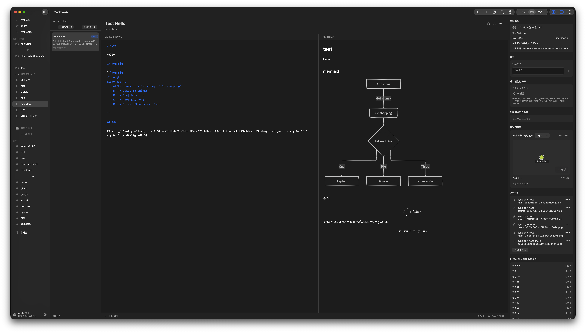
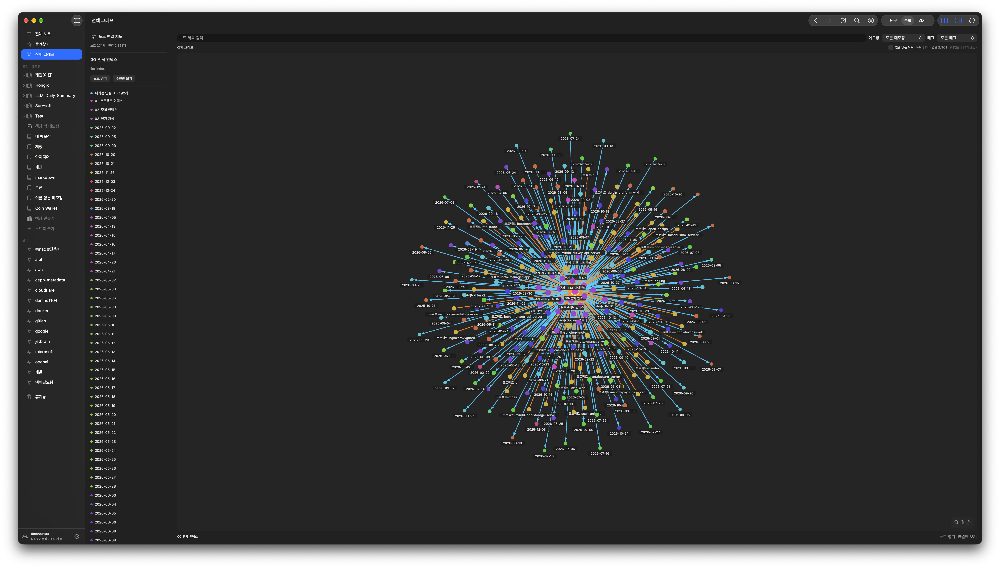

<h1 align="center">Synology Markdown Note</h1>

<div align="center">

**Synology Note Station의 노트를 Markdown으로 작성하고 관리하는 macOS 앱·웹·CLI입니다.**
  
[](https://github.com/damho1104/synology-markdown-note/releases)
[](https://github.com/damho1104/synology-markdown-note/pkgs/container/synology-md-note-web)
[](LICENSE)

,_Linux(Arm64,x86__64)-8b5cf6?style=for-the-badge)

</div>

<p align="center">
  <a href="https://buymeacoffee.com/damho1104q">
    
  </a>
</p>

<p align="center">
  <a href="README.md">English</a> | <strong>한국어</strong>
</p>

---

기존 NAS의 책장·메모장·노트를 그대로 사용합니다. Mac에서는 전용 앱으로, 다른 기기에서는 웹 브라우저로, 터미널에서는 `synonote` 명령으로 사용할 수 있습니다.

[앱·CLI 다운로드](https://github.com/damho1104/synology-markdown-note/releases/latest) · [웹 설치 안내](web/SELF-HOSTING_KO.md) · [CLI 사용법](cli/README_KO.md)



Synology가 제작하거나 지원하는 공식 제품이 아닌 독립적인 오픈소스 프로젝트입니다. Synology 및 Note Station 명칭은 해당 권리자의 상표입니다.

## 어떤 방식으로 사용할까요?

| 클라이언트 | 사용 환경 | 이런 용도에 적합합니다 |
| --- | --- | --- |
| **macOS 앱** | macOS 14 이상 · Apple Silicon | Mac에서 편집·검색하고 오프라인에서도 작업 |
| **웹** | 브라우저 + Docker 서버 | 기기에 앱을 설치하지 않고 NAS 노트에 접속 |
| **CLI (`synonote`)** | macOS · Linux x86_64 | 터미널에서 노트 탐색, Markdown 업로드·다운로드, 스크립트 연동 |

모두 **Note Station이 설치된 Synology NAS와 NAS 계정**이 필요합니다. 웹은 Docker를 실행할 서버에 한 번 설치하면 브라우저로 접속할 수 있습니다.

## 주요 기능

### macOS 앱

- **Markdown 편집:** 원문·분할·읽기 보기, 기존 Note Station 일반 노트 편집.
- **자동 저장·동기화:** 변경 내용을 Mac에 먼저 저장하고 NAS로 전송. 오프라인 작업 후 재연결 시 동기화.
- **문서 미리보기:** Mermaid 다이어그램, KaTeX 수식, 이미지와 첨부파일.
- **검색과 연결:** 본문 검색, 내부 링크, 백링크, 전체·주변 노트 그래프.
- **노트 정리:** 책장·메모장, 태그·즐겨찾기, 이동·휴지통·복원, Markdown 가져오기·내보내기.

### 웹

- **브라우저 편집:** 원문·분할·읽기 보기와 자동 저장.
- **문서 미리보기:** Mermaid·수식 미리보기, 수식 PNG 저장, 편집 문단 따라가기.
- **검색과 연결:** 제목·미리보기·태그 검색, 내부 링크·백링크, 전체·주변 노트 그래프.
- **노트 정리:** 책장·메모장, 태그·즐겨찾기, 이동·휴지통·복원.
- **화면 설정:** 책장·노트 목록 접기, 밝은/어두운 화면, 편집기·다이어그램 설정.

### CLI

- **NAS 탐색:** 책장·메모장·노트 목록과 상세 정보 조회.
- **Markdown 파일 작업:** 업로드·다운로드, 기존 노트와 차이점 확인 후 덮어쓰기.
- **지식 인덱스:** 일일 요약 노트를 프로젝트·주제·연관 지식별로 정리.
- **자동화:** JSON 출력, 2단계 인증, 로그인 정보 저장 지원.

## 화면 미리보기

macOS 앱의 Markdown 분할 편집 화면입니다.


노트 간 연결을 전체 그래프로 탐색할 수 있습니다.



## 기술 스택

| 구성 요소 | 기술과 용도 |
| --- | --- |
| **macOS 앱** | Swift·SwiftUI·AppKit 기반 데스크톱 앱, WebKit 문서 미리보기, Swift Package Manager 빌드 |
| **Markdown·HTML 처리** | macOS 앱의 Markdown 파싱에 swift-markdown, HTML 처리에 SwiftSoup 사용 |
| **웹 프런트엔드** | React·TypeScript·Vite·Tailwind CSS 기반 브라우저 UI, CodeMirror 편집기 |
| **웹 백엔드** | Python 3.13·FastAPI·Uvicorn 기반 API, HTTPX NAS 통신, SQLite 로컬 상태 저장, cryptography 암호화 |
| **문서 렌더링** | Mermaid 다이어그램·KaTeX 수식, 웹의 marked Markdown 렌더링·DOMPurify HTML 정화 |
| **CLI** | Python 3.13·Typer·HTTPX·markdown-it-py·keyring, uv 의존성 관리, PyInstaller 단독 실행 파일 |
| **저장·배포** | NAS 노트는 Synology Note Station, macOS 로컬 데이터·웹 서버 상태는 SQLite, 웹 배포는 Docker Compose·GHCR의 amd64/arm64 이미지 |

## macOS 앱 설치

1. [최신 릴리스](https://github.com/damho1104/synology-markdown-note/releases/latest)의 **Assets**에서 `SynologyMarkdownNote-<버전>-arm64.dmg`를 받습니다.
2. DMG를 열고 **Synology Markdown Note.app**을 **Applications(응용 프로그램)** 폴더로 드래그합니다.
3. 앱을 실행하고 **설정 → Note Station**에서 NAS 주소와 계정을 입력해 로그인합니다.

### ⚠️ 중요 사항
릴리스 앱·CLI를 사용할 때 소스 코드나 Python을 설치할 필요는 없습니다. macOS 앱은 자체 서명 인증서를 사용하며 Apple 공증을 받지 않았습니다. 실행이 차단되면 파일 출처를 확인한 뒤 **시스템 설정 → 개인정보 보호 및 보안**의 열기 안내를 따르세요.

체크섬 확인과 자세한 설치 방법은 [설치·배포 안내](docs/distribution.ko.md)를 참고하세요.

### 처음 사용하기

- 메모장을 선택한 뒤 **새 노트** 또는 `⌘N`으로 노트를 만듭니다.
- `⇧⌘P`로 미리보기를 전환하고 `⇧⌘F`로 노트를 검색합니다.
- 편집 중 `[[`를 입력하면 다른 노트를 찾아 연결할 수 있습니다.
- 기존 Markdown 파일은 **파일 → Markdown 가져오기…**로 추가합니다.
- 오프라인에서 모든 노트를 사용하려면 **설정 → Note Station → 오프라인 보관**에서 전체 본문·첨부 보관을 켭니다.

## 웹 설치

Docker와 Docker Compose v2가 설치된 서버에서 실행합니다. Compose는 GHCR의 `ghcr.io/damho1104/synology-md-note-web:latest` 이미지를 사용하며 로컬 소스 빌드는 필요하지 않습니다.

```sh
# 1. 설치 폴더 생성
mkdir -p ~/synology-md-note-web && cd ~/synology-md-note-web

# 2. 파일 다운로드
wget https://raw.githubusercontent.com/damho1104/synology-markdown-note/main/web/docker-compose.yaml
wget -O .env https://raw.githubusercontent.com/damho1104/synology-markdown-note/main/web/.env.example

# 3. 필요한 설정만 .env에서 변경
# 내부망 NAS를 쓰는 경우: NAS_ALLOW_PRIVATE=true
# 다른 PC에서 직접 접속하는 경우: WEB_BIND_ADDRESS=0.0.0.0

# 4. 실행
docker compose up -d
```

같은 PC에서는 `http://localhost:8787`, 다른 PC에서는 `http://서버주소:8787`로 접속합니다. 기본값은 같은 PC에서만 접근할 수 있습니다.

NAS 주소를 `.env`에 미리 지정하지 않았다면 초기 설정 코드를 확인합니다.

```sh
docker compose exec web cat /data/setup-code
```

웹 최초 설정 화면에 NAS 주소와 코드를 입력한 뒤 NAS 계정으로 로그인하세요. 키와 코드는 자동 생성되며, **CA 경로는 일반 설치에서 필요하지 않습니다.**

### 웹 사용과 업데이트

노트를 선택하고 원문·분할 보기에서 편집하면 자동 저장합니다. 하단의 저장 상태를 확인할 수 있으며, 사이드바 아래 설정에서 화면·편집기 옵션과 앱 버전을 확인합니다.

업데이트는 기존 설치 폴더에서 실행합니다.

```sh
docker compose pull web
docker compose up -d
```

기존 `.env`와 데이터 볼륨은 유지하세요. 내부망 NAS, HTTPS 프록시, 선택 CA, 데이터 보관·백업 예시는 [셀프호스팅 안내](web/SELF-HOSTING_KO.md)에 있습니다.

## CLI 설치

[최신 릴리스](https://github.com/damho1104/synology-markdown-note/releases/latest)의 **Assets**에서 환경에 맞는 실행 파일과 체크섬을 받습니다. `<VERSION_TAG>`는 해당 릴리스의 태그로 바꿉니다.

| 환경 | 실행 파일 | 체크섬 |
| --- | --- | --- |
| macOS · Apple Silicon | `synonote-cli-<VERSION_TAG>-macos-arm64` | `SHA256SUMS-macos-arm64` |
| Linux x86_64 · glibc 2.28 이상 | `synonote-cli-<VERSION_TAG>-linux-glibc2.28-amd64` | `SHA256SUMS-linux-glibc2.28-amd64` |
| Ubuntu 22.04 x86_64 | `synonote-cli-<VERSION_TAG>-ubuntu-22.04-amd64` | `SHA256SUMS-ubuntu-22.04-amd64` |
| Ubuntu 24.04 x86_64 | `synonote-cli-<VERSION_TAG>-ubuntu-24.04-amd64` | `SHA256SUMS-ubuntu-24.04-amd64` |

Linux 공용 파일은 Debian·Ubuntu·AlmaLinux·Rocky Linux·Fedora·openSUSE에서 사용할 수 있습니다. **CLI 릴리스 파일은 Linux ARM64·Alpine(musl)·32비트를 지원하지 않습니다.** 웹 Docker 이미지는 amd64와 arm64를 지원합니다.

파일 권한과 PATH 설정, 체크섬 확인은 [CLI 설치 안내](cli/README_KO.md#설치)를 참고하세요.

### CLI 사용 예시

```sh
synonote login --server https://nas.example.com:5001 --username alice --remember
synonote notebook list --stack '업무'
synonote upload ./report.md --stack '업무' --notebook '일지'
synonote download --id NOTE_ID --output ./downloaded-report.md
```

자세한 명령과 인덱스 생성 예시는 [CLI 사용법](cli/README_KO.md)에 있습니다.

## 사용 전 알아두기

- **NAS 연결:** 앱·CLI는 HTTPS NAS 주소를 사용합니다. 웹은 `NAS_ALLOW_PRIVATE=true` 설정 시 내부망·HTTP NAS도 사용할 수 있습니다. HTTP NAS 연결에서는 계정 정보와 노트가 암호화되지 않습니다. QuickConnect ID만으로 접속하거나 인증서 검증을 우회하는 방식은 지원하지 않습니다.
- **기능 차이:** 웹의 일반 첨부 추가·삭제, 버전 이력, 오프라인 동기화는 macOS와 동일한 수준이 아닙니다. CLI는 파일 단위 도구이며 자동 동기화·자동 병합을 제공하지 않습니다. 암호화된 노트의 본문 편집은 지원하지 않습니다.
- **로그인 정보:** macOS 앱·CLI는 키체인을 사용할 수 있습니다. Linux CLI의 `--remember`는 평문 자격 정보 파일을 사용자 전용 권한으로 저장합니다. 웹의 로그인 유지는 서버에 암호화해 저장합니다. [CLI 인증 정보](cli/README_KO.md#로그인과-자동-로그인) · [웹 데이터 보관](web/README_KO.md#데이터-보관과-권한)
- **백업:** 노트 원본은 NAS에 있습니다. Note Station 백업을 유지하고 웹 `/data`와 macOS 로컬 데이터도 필요한 경우 별도로 보관하세요.

## 더 알아보기

- [전체 문서 목록](docs/README_KO.md)
- [웹 셀프호스팅 안내](web/SELF-HOSTING_KO.md)
- [웹 기능과 지원 범위](web/README_KO.md)
- [CLI 상세 안내](cli/README_KO.md)
- [앱·CLI 설치·배포 안내](docs/distribution.ko.md)
- [진단 로그](docs/diagnostics.ko.md)
- [개발 환경](docs/development-signing.ko.md) · [릴리스 관리](docs/github-release.ko.md)

## 라이선스와 문의

이 프로젝트의 자체 소스와 문서는 [MIT 라이선스](LICENSE)로 제공합니다. 외부 라이브러리와 리소스에는 각각의 라이선스가 적용됩니다. 번들에 포함된 [Mermaid](Sources/SynologyNote/Resources/MERMAID-LICENSE.txt)와 [KaTeX](Sources/SynologyNote/Resources/KATEX-LICENSE.txt)의 고지를 함께 확인하세요.

기여 방법은 [CONTRIBUTING.md](CONTRIBUTING_KO.md), 보안 문제 제보는 [SECURITY.md](SECURITY_KO.md)를 참고하세요.
