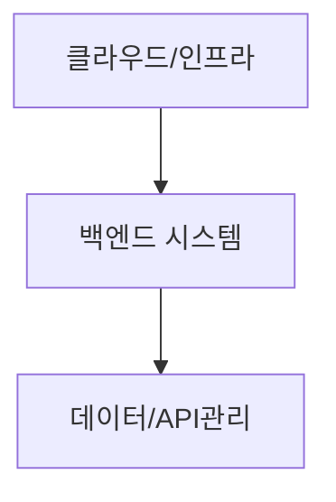

# Mermaid 미리보기

`설정 → 일반 → Mermaid 다이어그램`에서 표시 방식을 바꿀 수 있다.

- **그리기 스타일**: 기본 / 스케치. 처음에는 스케치를 사용한다.
- **색상 테마**: 화면 모드에 맞춤 / 라이트 / 다크 / 무채색 / 포레스트.

설정은 이 Mac에 저장되며, 열려 있는 미리보기에도 즉시 적용된다. 노트의 Markdown 원문은 바꾸지 않는다. 스케치의 선 모양은 미리보기를 다시 그려도 일정하게 유지한다. 스케치 지원 범위는 Mermaid의 다이어그램 종류에 따라 다르다.

일반 Mermaid 코드 블록을 그대로 사용하면 된다.

````markdown

````

`%% rough`는 Mermaid 주석이다. 스케치 적용 여부는 앱의 그리기 스타일로 선택한다. 노트에 Mermaid frontmatter나 초기화 지시문으로 스타일·테마를 명시하면 해당 다이어그램의 설정이 우선한다.

미리보기는 앱에 포함된 Mermaid로 오프라인 렌더링한다. [Mermaid 공식 설정](https://mermaid.js.org/config/setup/mermaid/interfaces/MermaidConfig.html)의 `look`과 `theme`를 사용한다.
