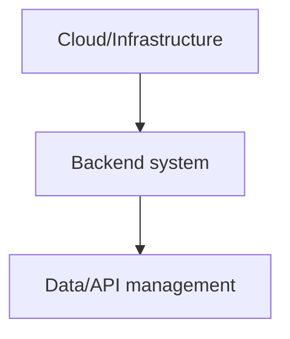

# Mermaid Preview

**English** | [한국어](mermaid-preview.ko.md)

Change the display options in `Settings → General → Mermaid Diagrams`.

- **Drawing style**: Default / Sketch. Sketch is selected initially.
- **Color theme**: Follow appearance / Light / Dark / Neutral / Forest.

Settings are saved on this Mac and immediately applied to open previews. They do not change the note's Markdown source. Sketch line shapes remain consistent when the preview is redrawn. Sketch support varies by Mermaid diagram type.

Use ordinary Mermaid code blocks as they are.

````markdown

````

`%% rough` is a Mermaid comment. The app's drawing style determines whether Sketch is applied. If a note explicitly specifies a style or theme through Mermaid frontmatter or initialization directives, those settings take precedence for that diagram.

Previews render offline using the Mermaid bundled with the app. They use `look` and `theme` from the [official Mermaid configuration](https://mermaid.js.org/config/setup/mermaid/interfaces/MermaidConfig.html).
